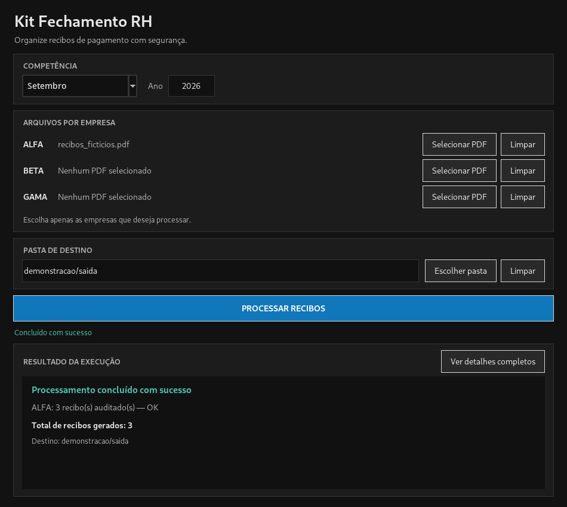

# Processador de Recibos

*Projeto empresarial · Versão de portfólio independente*

Automação em Python para separar, validar e auditar recibos mensais de pagamento recebidos em PDFs coletivos. A aplicação foi desenvolvida para reduzir o trabalho manual na organização de documentos do RH, preservar os arquivos originais e evitar a entrega de lotes inconsistentes.

## Contexto empresarial

Desenvolvido durante minha atuação como Analista de Dados no setor de logística, para atender uma demanda real de operação. A versão original foi entregue para uso interno; esta adaptação de portfólio preserva o fluxo técnico, sem dados ou identidade visual da empresa.

Este repositório contém exclusivamente a versão independente de portfólio, com histórico Git próprio. A implementação corporativa original é mantida separadamente e não é necessária para executar esta versão.

**Status da solução original:** V1.1.1 — entregue, homologada operacionalmente e em manutenção desde 19/11/2026, conforme confirmação da equipe responsável.

## Funcionalidades

- Extração de texto e separação de recibos individuais, preservando as duas vias de cada funcionário.
- Validação de empresa, CNPJ, competência, tipo de recibo e identificação do funcionário.
- Deduplicação de páginas idênticas com registro no relatório; divergências bloqueiam o fechamento.
- Pré-validação coletiva, geração em área temporária e auditoria antes da publicação das entregas.
- Revisões automáticas sem sobrescrever entregas anteriores.
- Relatório de processamento, interface desktop e distribuição para Windows.

## Demonstração

Os exemplos abaixo foram produzidos com dados integralmente fictícios, sem validade como documentos de pagamento. O identificador empresarial presente no exemplo é utilizado pelo parser; o CNPJ, os funcionários e os valores são sintéticos.

| Entrada | Resultado |
| --- | --- |
| 1 PDF coletivo, 3 páginas, 2 vias por funcionário | 3 PDFs individuais, 3 aprovados na auditoria, nenhuma pendência |

- [PDF coletivo de entrada](demonstracao/entrada/recibos_ficticios.pdf)
- [Recibos individuais gerados](demonstracao/saida/)
- O relatório de processamento é gerado junto aos recibos. Caminhos locais devem ser removidos antes de sua divulgação.



[Interface antes do processamento](demonstracao/imagens/01-tela-inicial.png)

## Tecnologias

Python 3.13+, PyMuPDF, Tkinter, pytest, setuptools, PyInstaller e Git.

## Arquitetura

```text
PDF coletivo
    -> extração e identificação
    -> validação do lote
    -> geração dos PDFs em área temporária
    -> auditoria dos arquivos
    -> publicação controlada e relatório
```

| Módulo | Responsabilidade |
| --- | --- |
| `analisador_pagina.py`, `leitor_pdf.py` | Extração e identificação dos campos |
| `validador_lote.py`, `configuracao_empresas.py` | Regras de validação e configuração local |
| `gerador_kits.py`, `auditor_saida.py` | Geração e auditoria dos recibos |
| `processador.py`, `processador_fechamento.py` | Orquestração do processamento e publicação coletiva |
| `relatorio_processamento.py`, `interface.py` | Relatório de execução e interface desktop |

## Instalação e testes

Na raiz do projeto (Windows/PowerShell):

```powershell
python -m venv .venv
.\.venv\Scripts\python.exe -m pip install -e ".[dev]"
.\.venv\Scripts\python.exe -m pytest -q
```

**56 testes automatizados aprovados** na validação da versão de portfólio em 25/11/2026 (Linux e Windows, Python 3.13), incluindo a validação final após a atualização do nome. Os testes utilizam PDFs e configurações sintéticas, incluindo falhas simuladas e reprocessamento.

Para executar a demonstração, copie `config/empresas.example.json` para `config/empresas.local.json`. Cada chave é um nome ou prefixo de empresa presente no cabeçalho dos recibos, associado ao CNPJ esperado. É possível cadastrar outras empresas, sem alterar o código. O formato de recibo suportado permanece o mesmo. A demonstração usa ALFA e um CNPJ fictício. Execute:

```powershell
Copy-Item config/empresas.example.json config/empresas.local.json
.\.venv\Scripts\python.exe -m kit_fechamento_rh.interface
```

Selecione Setembro/2026, o PDF fictício no campo da empresa correspondente e uma pasta de destino nova, fora de qualquer pasta operacional. Não use dados reais para experimentar a aplicação.

## Confiabilidade e limites

- O fechamento coletivo pré-valida os lotes selecionados antes de gerar qualquer entrega. A publicação ocorre somente após geração, auditoria e relatórios concluídos com sucesso. Falhas tratáveis durante a publicação acionam tentativa de reversão.
- A V1.1.1 corrigiu a criação de diretórios temporários no Windows para permitir a aplicação das políticas de acesso do destino, sem conceder permissões explícitas pelo aplicativo. A distribuição por ZIP completo resolveu uma falha de cópia avulsa de dependências pela rede.
- Não existe publicação única e atômica de múltiplos diretórios independentes. Em falha abrupta ou reversão incompleta, é necessário conferir o destino antes de usar os arquivos.
- O escopo é restrito a recibos mensais com texto extraível. Recibos de adiantamento e montagem do kit completo não fazem parte desta versão.

## Privacidade e distribuição

Nunca versionar recibos reais, saídas operacionais, logs pessoais, configurações locais ou pacotes corporativos. A configuração `config/empresas.local.json` deve permanecer privada. O executável Windows utiliza a distribuição completa `--onedir` do PyInstaller, incluindo `_internal`; os pacotes corporativos não integram esta demonstração. Qualquer divulgação de código ou materiais empresariais depende de autorização.
